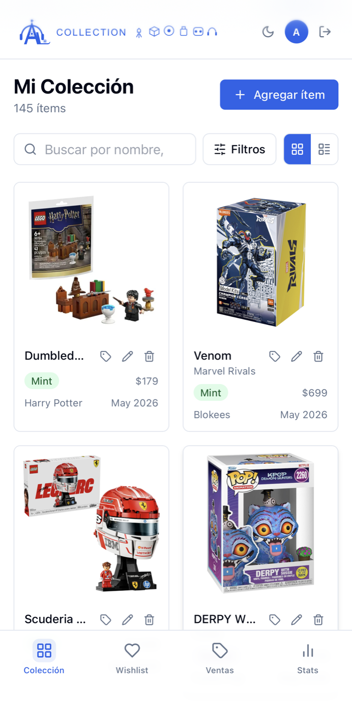
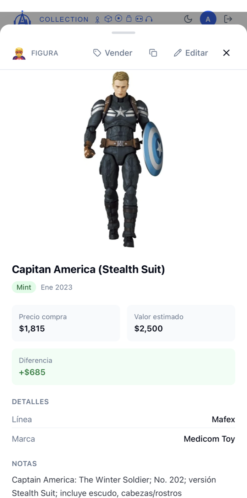
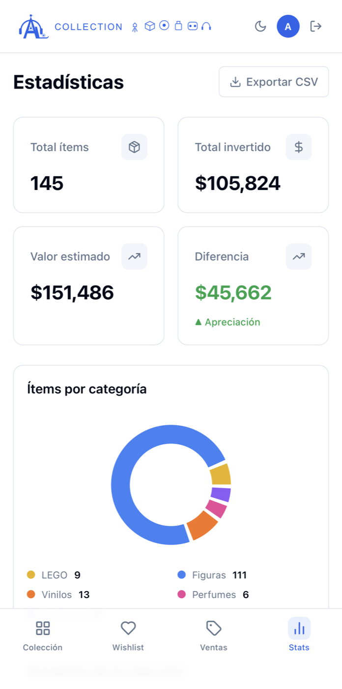

# Colección AL

Aplicación web mobile-first para catalogar, consultar y analizar colecciones personales. Centraliza fotografías, categorías, condición, datos de adquisición, valor estimado, wishlist y seguimiento de ventas en una sola interfaz.

**[Probar la aplicación](https://coleccion.al-miniserver.dev)**

> La instancia pública requiere crear una cuenta. Cada usuario consulta y administra únicamente sus propios registros mediante autenticación y políticas Row Level Security de Supabase.

## Vista previa

<table>
  <tr>
    <th>Colección</th>
    <th>Detalle del ítem</th>
    <th>Estadísticas</th>
  </tr>
  <tr>
    <td></td>
    <td></td>
    <td></td>
  </tr>
</table>

## Funcionalidades

- Registro, edición, duplicado y eliminación de piezas de una colección.
- Categorías especializadas para figuras, audífonos, vinilos, LEGO y perfumes.
- Hasta tres fotografías por ítem, con carrusel y visualización ampliada.
- Control de condición, precio de adquisición, valor estimado y fecha de compra.
- Campos específicos por categoría mediante metadatos flexibles.
- Búsqueda por nombre, marca, línea o artista.
- Filtros por categoría, condición, marca y subcategoría.
- Ordenamiento por fecha, nombre, precio, valor estimado o año de adquisición.
- Vistas de cuadrícula y lista, paginación y preferencias persistentes.
- Wishlist con prioridades, precio objetivo y enlace de referencia.
- Flujo de venta con precio solicitado, precio final, fecha y utilidad calculada.
- Panel estadístico con inversión, valor estimado, distribución y marcas principales.
- Exportación de la colección a CSV.
- Interfaz responsive, navegación móvil, gestos y temas claro y oscuro.

## Tecnologías

| Capa | Tecnologías |
|---|---|
| Interfaz | React 18, TypeScript, Vite |
| Estilos | Tailwind CSS, CSS |
| Datos y caché | TanStack Query |
| Visualización | Recharts |
| Backend administrado | Supabase Auth, PostgreSQL y Storage |
| Seguridad | Row Level Security por usuario |
| Despliegue | Docker y Nginx |

## Arquitectura

```text
Usuario
  │
  ▼
React + TypeScript
  │
  ├── autenticación
  ├── consultas y mutaciones
  ├── caché con TanStack Query
  ├── estadísticas con Recharts
  └── carga de fotografías
  │
  ▼
Supabase
  ├── Auth
  ├── PostgreSQL + Row Level Security
  └── Storage
```

## Modelo de datos

La aplicación separa los registros por usuario y trabaja con dos entidades principales:

- `collection_items`: datos generales, categoría, estado, condición, valores, fotografías y metadatos específicos.
- `wishlist_items`: artículos deseados, prioridad, precio objetivo y fuente de referencia.

El flujo de venta se representa mediante los estados `owned`, `for_sale` y `sold`, junto con la información del precio y la fecha de venta.

El esquema y sus cambios incrementales están disponibles en [`supabase/schema.sql`](supabase/schema.sql) y [`supabase/`](supabase/).

## Ejecución local

### Requisitos

- Node.js 22.13 o posterior
- npm
- Un proyecto de Supabase

### Instalación

```bash
git clone https://github.com/dev1206al/Coleccion_AL.git
cd Coleccion_AL
npm install
```

Crea el archivo de variables locales:

```bash
cp .env.example .env.local
```

Configura las credenciales públicas de tu proyecto:

```env
VITE_SUPABASE_URL=https://tu-proyecto.supabase.co
VITE_SUPABASE_ANON_KEY=tu-anon-key-aqui
```

Aplica [`supabase/schema.sql`](supabase/schema.sql) y después las migraciones de [`supabase/`](supabase/) en orden numérico. Crea también el bucket público `collection-images` con sus políticas de acceso.

Inicia la aplicación:

```bash
npm run dev
```

Vite mostrará la dirección local en la terminal, normalmente `http://localhost:5173`.

## Comandos disponibles

```bash
npm run dev      # servidor de desarrollo
npm run build    # comprobación de TypeScript y build de producción
npm run lint     # análisis estático con ESLint
npm run preview  # vista previa del build
```

## Docker

El repositorio incluye una imagen multietapa: Node compila la aplicación y Nginx sirve los archivos estáticos con fallback para las rutas del SPA.

```bash
docker build -t coleccion-al .
docker run --rm -p 8080:80 coleccion-al
```

> Las variables `VITE_*` se incorporan durante la compilación. Configura `.env.local` antes de construir la imagen; pasarlas únicamente con `docker run -e` no modifica el bundle generado.

## Estructura

```text
Coleccion_AL/
├── public/                  # logotipos y manifiesto de instalación
├── src/
│   ├── components/          # formularios, tarjetas y paneles
│   ├── contexts/            # autenticación y notificaciones
│   ├── hooks/               # consultas, mutaciones y gestos
│   ├── lib/                 # Supabase, almacenamiento y utilidades
│   ├── pages/               # colección, wishlist, ventas y estadísticas
│   └── types/               # modelo de la colección
├── supabase/                # esquema y migraciones
├── Dockerfile
├── nginx.conf
└── vercel.json
```

## Privacidad y alcance

- Las políticas RLS relacionan cada consulta con el usuario autenticado.
- Las imágenes se almacenan en rutas asociadas al identificador del usuario.
- La clave `anon` de Supabase es pública por diseño; la protección depende de políticas RLS correctamente configuradas.
- No deben incluirse claves de servicio, contraseñas ni archivos `.env` en el repositorio.

## Autor

**Luis Enrique Alvarez Segura**<br>
Ingeniería en Computación, Universidad Autónoma Metropolitana<br>
[LinkedIn](https://www.linkedin.com/in/luis-enrique-alvarez-segura) · [GitHub](https://github.com/dev1206al)

## Licencia

Este repositorio todavía no declara una licencia de uso. El código permanece bajo los derechos de su autor hasta que se agregue una licencia explícita.
